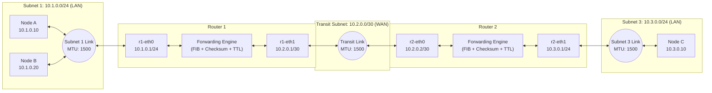
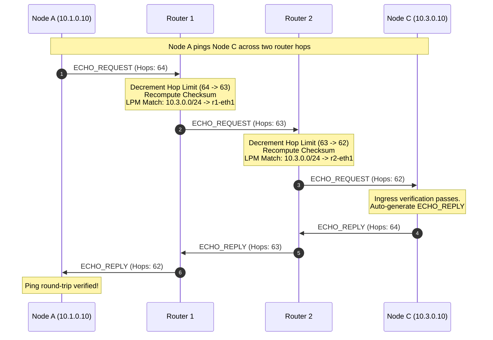

# AKIP: Akhil's Custom Internet Protocol (Educational Prototype)

> **Research-Grade Custom Network-Layer Protocol Simulator in Python 3**

AKIP is an educational network-layer (OSI Layer 3) protocol simulator developed from first principles. Unlike conventional socket applications (which sit at the Application Layer over TCP or UDP), AKIP implements true packet-level internetworking: binary serialization, big-endian byte-order struct manipulation, 32-bit logical addressing with CIDR prefix matching, link MTU enforcement, hop-limit loop prevention, and multi-hop router forwarding using Longest Prefix Match (LPM).

---

## ⚠️ Important Safety Statement: Simulation vs. Real IP Replacement

> [!NOTE]
> **This software is a user-space discrete simulation, NOT an operating-system kernel IP replacement.**

| Feature | AKIP Simulator (This Project) | Real Operating System IP (IPv4/IPv6) |
|---|---|---|
| **Execution Environment** | Pure Python 3 user-space memory | OS Kernel (`tcpip.sys` on Windows, `net/ipv4` on Linux) |
| **Privileges Required** | Normal user permissions (no admin required) | Root / Administrator raw socket privileges (`SOCK_RAW`) |
| **System Modification** | Modifies **zero** system network settings | Manages physical NICs, ARP tables, and kernel routing tables |
| **Traffic Scope** | Isolated in-memory links and callbacks | Transmits electrical/optical frames over physical Ethernet/WiFi |
| **Network Safety** | **100% safe**. No packets ever leave the Python process | Can disrupt local LAN or violate ISP policies if misconfigured |

---

## Architecture & Network Topology

AKIP models a classic three-node, two-router, multi-subnet internetwork:



### End-to-End Ping Flow


---

## File-by-File Beginner-Friendly Tour

Here is what each file in the codebase does in plain English:

### 1. `akip/packet.py` — The Wire Format & Checksum Engine
- **What it does:** Defines the 20-byte binary header using Python's `struct` module.
- **Why it matters:** Network protocols don't send JSON or text over the wire; they pack numbers and addresses tightly into raw bytes using **big-endian (network byte order)**. This file handles packing (`encode`), unpacking (`decode`), and computing the **RFC 1071 16-bit one's complement checksum**. It also catches malformed packets, corrupted magic headers (`b"AK"`), bad version numbers, and payload length mismatches.

### 2. `akip/address.py` — 32-Bit Addressing & CIDR Subnets
- **What it does:** Provides `AKIPAddress` and `AKIPNetwork` classes.
- **Why it matters:** Translates human-readable dotted-decimal strings (e.g., `10.1.0.10`) into 32-bit unsigned integers and 4-byte sequences. Calculates network addresses, broadcast addresses, and netmasks (e.g., `/24` $\rightarrow$ `255.255.255.0`), allowing nodes and routers to test whether an IP is on their local subnet.

### 3. `akip/link.py` — The Simulated Physical / Data Link
- **What it does:** Represents a physical network cable or switch connecting network interfaces.
- **Why it matters:** Enforces the **Maximum Transmission Unit (MTU)** (dropping packets that are too large), simulates propagation latency, and allows researchers to intentionally inject packet loss or **flip bits in the middle of a frame** to test whether the receiver's checksum detects corruption.

### 4. `akip/routing.py` — The Routing Table & LPM Engine
- **What it does:** Implements the Forwarding Information Base (FIB) and the **Longest Prefix Match (LPM)** algorithm.
- **Why it matters:** When a packet arrives with a destination IP, the router might have multiple matching routes (e.g., `0.0.0.0/0` default route, `10.0.0.0/8`, and `10.1.0.0/24`). LPM ensures the router always chooses the **most specific** route (highest prefix length), breaking ties with route metrics.

### 5. `akip/router.py` — The Multi-Homed Forwarding Router
- **What it does:** Models a hardware router with multiple network interfaces (`Interface`).
- **Why it matters:** Acts as the traffic cop. It checks if a packet is for itself (e.g., pinging the router), decrements the hop limit by 1 (dropping packets when TTL hits 0 to stop loops), updates the checksum, looks up the egress interface in the routing table, prevents hairpin reflection loops on broadcast links, and emits telemetry.

### 6. `akip/node.py` — End-Host Computers
- **What it does:** Represents user devices like Node A, Node B, and Node C.
- **Why it matters:** Contains an IP address, subnet mask, default gateway, and an inbox/outbox. Implements an automatic Echo Reply responder so you can "ping" any node in the topology.

### 7. `akip/topology.py` — Network Builder
- **What it does:** Wires up the 3 nodes, 2 routers, and 3 simulated links with full IP addressing and static routes in a single helper function (`create_reference_topology()`).

### 8. `demo.py` — Interactive Protocol Demonstration
- **What it does:** A runnable demonstration script that prints the bit-level packet breakdown, traces packets across the topology, tests round-trip pings, and executes fault scenarios (corrupted checksums, TTL expiry, unknown routes).

### 9. `run_tests.py` & `tests/` — Test Suite
- **What it does:** 38 automated unit and integration tests covering addresses, packets, links, routing tables, multi-hop forwarding, and every failure mode without needing external third-party dependencies.

---

## Quickstart & How to Run

AKIP requires only **Python 3.8+** from the standard library (no pip packages needed).

### Run the Automated Test Suite
```bash
python run_tests.py
```

Expected output:
```text
Ran 38 tests in 0.007s
OK
```

### Run the Interactive Live Demonstration
```bash
python demo.py
```

---

## Research Fault Scenarios Demonstrated

| Failure Mode | How It Is Triggered | Expected Protocol Behavior |
|---|---|---|
| **Bit Corruption** | Link flips bit in transit | Receiver recomputes checksum; mismatch raises `ChecksumError` and drops frame. |
| **Hop Limit Expiry** | Node sends with `hop_limit=1` | First router decrements to 0; raises `HopLimitExpiredError` and drops frame. |
| **No Route (FIB Miss)**| Node sends to `192.168.99.1` | Router looks up destination; finds no matching prefix; drops with `DROPPED_NO_ROUTE`. |
| **Packet Too Short** | Frame is $< 20$ bytes | Header unpacking fails; dropped with `PacketTooShortError`. |
| **Bad Magic Header** | Header magic $\neq$ `b"AK"` | Protocol discriminator check fails; dropped with `InvalidMagicError`. |
| **MTU Exceeded** | Packet size $>$ Link MTU | Link drops frame immediately; raises `MtuExceededError`. |
