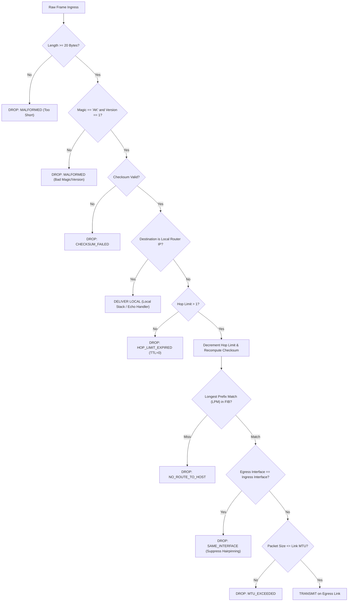

# AKIP Protocol Specification (RFC-Style Draft)

**Protocol Name:** AKIP (Akhil's Custom Internet Protocol)  
**Version:** 1.0  
**Status:** Educational & Research Prototype  
**Network Layer:** Layer 3 (Internetwork Packet Delivery)  

---

## 1. Introduction

AKIP (Akhil's Custom Internet Protocol) is a connectionless, datagram-oriented network-layer protocol designed for research, protocol design analysis, and computer networking pedagogy.

Unlike application-layer messaging systems running over TCP or UDP, AKIP models genuine Layer 3 internetworking:
- Encapsulation and raw binary serialization using big-endian network byte order.
- Hierarchical 32-bit logical addressing with CIDR prefix matching.
- Hop-by-hop forwarding via multi-homed routers.
- Loop prevention via decrementing hop limits.
- End-to-end and header integrity verification using RFC 1071 one's complement checksums.

---

## 2. Binary Packet Format

An AKIP datagram consists of a fixed **20-octet (160-bit) header**, followed immediately by a variable-length octet payload.

```text
 0                   1                   2                   3
 0 1 2 3 4 5 6 7 8 9 0 1 2 3 4 5 6 7 8 9 0 1 2 3 4 5 6 7 8 9 0 1
+-+-+-+-+-+-+-+-+-+-+-+-+-+-+-+-+-+-+-+-+-+-+-+-+-+-+-+-+-+-+-+-+
|       Magic ID ('A', 'K')     |    Version    |    Protocol   |
+-+-+-+-+-+-+-+-+-+-+-+-+-+-+-+-+-+-+-+-+-+-+-+-+-+-+-+-+-+-+-+-+
|   Hop Limit   |     Flags     |          Packet ID            |
+-+-+-+-+-+-+-+-+-+-+-+-+-+-+-+-+-+-+-+-+-+-+-+-+-+-+-+-+-+-+-+-+
|         Payload Length        |          Source Address       |
+-+-+-+-+-+-+-+-+-+-+-+-+-+-+-+-+-+-+-+-+-+-+-+-+-+-+-+-+-+-+-+-+
|      Source Address (cont.)   |        Destination Address    |
+-+-+-+-+-+-+-+-+-+-+-+-+-+-+-+-+-+-+-+-+-+-+-+-+-+-+-+-+-+-+-+-+
|   Destination Address (cont.) |           Checksum            |
+-+-+-+-+-+-+-+-+-+-+-+-+-+-+-+-+-+-+-+-+-+-+-+-+-+-+-+-+-+-+-+-+
|                       Payload (variable)                      |
+-+-+-+-+-+-+-+-+-+-+-+-+-+-+-+-+-+-+-+-+-+-+-+-+-+-+-+-+-+-+-+-+
```

### 2.1 Header Field Definitions

| Field Name | Size (Bits) | Byte Offset | Type / Encoding | Description |
|---|---|---|---|---|
| **Magic ID** | 16 | 0–1 | ASCII `b"AK"` (`0x414B`) | Protocol discriminator. Frames without this signature are discarded immediately. |
| **Version** | 8 | 2 | Unsigned 8-bit (`0x01`) | Format version. Future revisions increment this field. |
| **Protocol** | 8 | 3 | Unsigned 8-bit enum | Identifies the upper-layer protocol or diagnostic handler. |
| **Hop Limit** | 8 | 4 | Unsigned 8-bit integer | Prevents forwarding loops. Decremented by 1 at every router hop. Discarded if 0. |
| **Flags** | 8 | 5 | Bitmask | Control flags (DF, MF, Priority/QoS). |
| **Packet ID** | 16 | 6–7 | Unsigned 16-bit integer | Unique datagram sequence identifier for tracing, debugging, and reassembly. |
| **Payload Length** | 16 | 8–9 | Unsigned 16-bit integer | Length of the payload in octets (0 to 65,535). Excludes the 20-byte header. |
| **Source Address** | 32 | 10–13 | 4 Octets (Big-Endian) | Originating node's 32-bit AKIP address. |
| **Destination Address**| 32 | 14–17 | 4 Octets (Big-Endian) | Target node's 32-bit AKIP address. |
| **Checksum** | 16 | 18–19 | Unsigned 16-bit integer | 16-bit one's complement checksum computed over the packet with this field zeroed. |

### 2.2 Protocol Identifiers

```text
0x00: RESERVED
0x01: ECHO_REQUEST   (Diagnostic Ping Request)
0x02: ECHO_REPLY     (Diagnostic Ping Reply)
0x03: DATA           (Standard Network Layer User Payload)
0x04: ROUTER_ALERT   (Router Control / Management)
0x05: ERROR_REPORT   (Unreachable / Hop Limit Exceeded Status)
```

### 2.3 Flags Bitmask

```text
Bit 0 (0x01): DONT_FRAGMENT (DF) - Informs intermediate links not to fragment.
Bit 1 (0x02): MORE_FRAGMENTS (MF) - Set on all fragments except the last.
Bit 7 (0x80): PRIORITY_HIGH - Expedited forwarding / QoS queuing marker.
```

---

## 3. Checksum Specification

AKIP adopts the standard Internet Checksum algorithm (RFC 1071):

1. The checksum field in the header is populated with zero (`0x0000`).
2. The entire datagram (header + payload) is treated as a continuous sequence of 16-bit integers in network byte order.
3. If the total byte length is odd, a zero octet is temporarily appended to the end for the calculation.
4. All 16-bit words are summed using 32-bit integer arithmetic.
5. All carry bits (bits beyond bit 15) are folded back into the lower 16 bits until the sum fits in 16 bits:
   $$\text{sum} = (\text{sum} \ \& \ \text{0xFFFF}) + (\text{sum} \gg 16)$$
6. The bitwise one's complement ($\sim\text{sum}$) is computed and stored in the checksum field.
7. Upon receipt, recomputing the algorithm yields the exact expected checksum. Any mismatch indicates bit corruption.

---

## 4. Addressing & Subnet Architecture

AKIP addresses are 32-bit unsigned integers represented in dotted-quad decimal notation:
$$\text{Octet}_0.\text{Octet}_1.\text{Octet}_2.\text{Octet}_3 \quad (\text{e.g., } 10.1.0.10)$$

### 4.1 Subnetting (CIDR)
Subnets are denoted using CIDR notation `Address/PrefixLength` (e.g., `10.1.0.0/24`).
- **Netmask Computation:** The top $P$ bits are set to 1, remaining $(32 - P)$ bits are set to 0.
- **Network Address:** $\text{Address} \ \& \ \text{Netmask}$
- **Directed Broadcast Address:** $\text{Network Address} \ | \ (\sim\text{Netmask} \ \& \ \text{0xFFFFFFFF})$
- **Containment Test:** An address $A$ belongs to subnet $N$ if:
  $$(A \ \& \ \text{Netmask}) == \text{Network Address}$$

---

## 5. Router Forwarding Algorithm

When a router interface receives an AKIP packet, it executes the following deterministic pipeline:



### Longest Prefix Match (LPM)
When searching the Forwarding Information Base (FIB):
1. Candidate routes are filtered such that `route.network.contains(packet.dst)`.
2. Candidates are sorted primarily by `prefix_len` descending (a `/24` match overrides a `/16` or `/0` default route).
3. Ties are broken by the lowest administrative `metric`.
